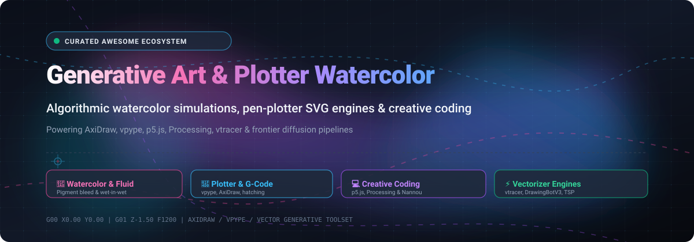

# 🎨 Awesome-Generative-Art-Plotter-Watercolor-Tools

  

  
  
  
  
  
  

---

# 🖌️ Top Generative Art, Pen Plotter & Algorithmic Watercolor Tools

> **A curated, production-grade guide to generative art engines, pen-plotter toolpaths, watercolor fluid simulations, creative coding frameworks, and high-performance vectorizers.**

**Last updated: November 2026** 📅 • **Maintained by [@ishandutta2007](https://github.com/ishandutta2007)** 🚀

Welcome to the definitive index for **Generative Art, Pen Plotter Pipelines, and Algorithmic Watercolor Painting**. Whether you are an algorithmic artist bridging virtual pixels to physical paper with an AxiDraw or custom CNC gantry, a creative coder writing shader-based pigment simulations in `p5.js` or `Processing`, or an engineer seeking optimized vector paths via `vpype` and `vtracer`, this directory covers both frontier commercial SaaS platforms and premier open-source repositories.

### 🌟 Key Focus Areas
- 🎨 **Algorithmic Watercolor & Fluid Dynamics**: Simulating physical paper texture, wet-in-wet capillary bleed, pigment accumulation, and watercolor drying edges (`Ramotion/aquarelle`, `acamposuribe/p5.brush`, `msurguy/watercolor-playground`).
- 📐 **Pen Plotter Path Optimization & Hardware Drivers**: Vector cleanup, line merging, hidden-line removal, TSP art, and servo control (`abey79/vpype`, `evil-mad/axidraw`, `nornagon/saxi`, `fogleman/axi`, `domoszlai/juicy-gcode`).
- ⚡ **Image-to-Vector & Hatching Engines**: Converting bitmap photos into single-line strokes, stippling patterns, and cross-hatching contours (`visioncortex/vtracer`, `SonarSonic/DrawingBotV3`, `LingDong-/linedraw`, `evil-mad/stipplegen`, `javierbyte/pintr`).
- 💻 **Creative Coding Frameworks**: Flexible procedural coding ecosystems across JavaScript, Rust, C++, and Java (`processing/p5.js`, `openframeworks/openFrameworks`, `nannou-org/nannou`, `mattdesl/canvas-sketch`).
- ☁️ **Frontier Generative Multimodal Platforms**: Commercial AI studios generating pristine vector paths, painterly aesthetics, and reference styles (`OpenAI`, `Adobe Firefly`, `Recraft`, `Midjourney`, `Black Forest Labs`).

---

## 📑 Table of Contents

- [📊 Sector Overview & Market Dynamics](#-sector-overview--market-dynamics)
- [☁️ SaaS & Hosted Commercial Platforms](#️-saas--hosted-commercial-platforms)
- [💻 Open-Source GitHub Projects](#-open-source-github-projects)
- [🛠️ How to Contribute](#️-how-to-contribute)
- [📈 Star History](#-star-history)
- [💖 Support & Sponsorship](#-support--sponsorship)
- [⚠️ Disclaimer](#️-disclaimer)

---

## 📊 Sector Overview & Market Dynamics

The global Generative AI Art, Vector Design & Digital Creative Tools market is valued at approximately **$8.4B–$11.5B+ in 2026**, expanding at a rapid **~28%–36% CAGR** alongside a vibrant physical-computing revival in **algorithmic pen plotting, brush plotters (AxiDraw, iDraw, Bantam), and generative watercolor painting**. 

While commercial AI image and SVG generation platforms exhibit **strong market consolidation** around major frontier labs (OpenAI, Adobe Firefly, Midjourney, Recraft, Canva/Leonardo), the **pen-plotter G-code/SVG toolchain, generative watercolor simulation, and creative coding frameworks are overwhelmingly open-source driven and decentralized** (`p5.js`, `vpype`, `vtracer`, `DrawingBotV3`, `saxi`, `Inkscape`). Artists and engineers routinely combine both paradigms—synthesizing concept line art or watercolor textures with frontier models, and subsequently processing, sorting, and plotting them using open-source vector engines.

---

## ☁️ SaaS & Hosted Commercial Platforms

*Sorted descending by company valuation / annual revenue scale.*

| Platform | Description | Company Scale (Valuation / Revenue) | Pricing (Starting Tier) | Free Tier / Trial Limits |
| :--- | :--- | :--- | :--- | :--- |
| **[OpenAI (DALL·E 3 / GPT Image)](https://openai.com)** | Multimodal AI art generator producing watercolor-style illustrations and line-art concepts convertible into plotter SVGs. | **~$157B+ Valuation** (~$4B+ ARR run-rate) | **$20 / month** (ChatGPT Plus plan) or **$0.040 / image** (DALL-E 3 standard 1024×1024 API) | **Forever Free Plan**: **2 image generations per rolling 24-hour window** on ChatGPT Free tier; API accounts require pay-as-you-go prepaid credits |
| **[Adobe Firefly](https://adobe.com)** | Commercially safe generative AI image and Text-to-Vector SVG studio trained on licensed Adobe Stock, ideal for clean vector line art. | **Part of Adobe Inc.** (~$21.5B+ annual revenue; ~$220B+ market cap) | **$4.99 / month** for Firefly Standard Plan (100 generative credits/month) | **Forever Free Plan**: **25 free generative credits per month** resetting on the 1st of each billing cycle with watermarked downloads on free Adobe ID accounts |
| **[Leonardo.ai (Canva)](https://leonardo.ai)** | Production AI art, real-time canvas, and custom style fine-tuning platform for watercolor illustrations, ink sketches, and concept art. | **Acquired by Canva for ~$370M+** (Part of $26B+ Canva valuation; ~$2.5B+ Canva ARR) | **$10 / month** billed annually ($12/month billed monthly for Apprentice plan with 8,500 fast tokens/month) | **Forever Free Plan**: **150 fast tokens daily** (resets every 24 hours, yields up to 75 images daily with standard prompt/model settings and public visibility) |
| **[Black Forest Labs (FLUX.1 / FLUX Pro API)](https://blackforestlabs.ai)** | Frontier Rectified Flow image models (`FLUX.1 [pro]`, `FLUX.1.1 [pro] Ultra`) excelling at intricate line art, botanical watercolors, and geometric prints. | **~$1.0B+ Valuation** ($31M+ seed/Series A; founded by core Stable Diffusion architects) | **$0.030 – $0.060 / image** pay-as-you-go via BFL API ($0.04/image on partner platforms like Replicate/fal.ai) | **Free Open Weights & Partner Trial**: Free self-hosted Apache 2.0 license for `FLUX.1 [schnell]` (forever free locally); hosted web trials via Replicate/fal.ai offer **$5 introductory trial credits** |
| **[Midjourney](https://midjourney.com)** | Artistic AI image synthesis platform celebrated for expressive watercolor washes, ink stippling aesthetics, and style references (`--sref`). | **~$300M+ Annual Revenue** (Bootstrapped, profitable independent AI research lab) | **$8 / month** billed annually ($10/month billed monthly for Basic Plan, ~200 fast GPU minutes / ~200 images/month) | **Mobile App Trial Only**: **20 free trial image generations** exclusively via the official niji·journey mobile app (iOS/Android); main web/Discord platform has **0 free trial days / requires $10/month minimum subscription** |
| **[Stability AI (Stable Diffusion Cloud / DreamStudio)](https://stability.ai)** | Hosted cloud API and DreamStudio web interface for Stable Diffusion 3.5 Large, SDXL, ControlNet line-art extraction, and style LoRAs. | **~$1.0B Peak Valuation** ($80M+ recapitalization; enterprise & developer API focus) | **$10 one-time credit purchase** (1,000 credits at ~3.5 to 6.5 credits per generation = ~$0.035 – $0.065 / image) | **Free Starter API Balance**: **25 free API credits** on initial account registration (~4–7 free generations) + perpetual free self-hosted SD 3.5 / SDXL weights under Community License |
| **[Ideogram](https://ideogram.ai)** | Generative AI image platform featuring strong typographic posters, monochrome ink line art, and Magic Prompt canvas editing. | **~$300M–$500M+ Valuation** ($80M+ Series A led by Andreessen Horowitz) | **$7 / month** billed annually ($8/month billed monthly for Basic plan with 400 priority prompt credits/month) | **Forever Free Plan**: **10 slow credits per week** (approximately 40 images/week) with standard queue speed and public visibility |
| **[Recraft](https://recraft.ai)** | Infinite-canvas AI design studio generating true editable SVG vector paths, clean single-stroke art, and watercolor/gouache style sets. | **~$150M–$300M Est. Valuation** ($12M+ Series A; #1 Hugging Face Text-to-Image Arena leader) | **$10 / month** billed annually ($12/month billed monthly for Basic plan with 1,000 monthly credits) | **Forever Free Plan**: **50 free credits daily** (resets every 24 hours, yields up to ~25–50 images or vector conversions daily) with public canvas visibility |
| **[NightCafe](https://nightcafe.studio)** | Multi-model AI art generator and creator community offering FLUX, SDXL, DALL·E 3, and neural style transfer for watercolor and ink aesthetics. | **~$10M–$25M Est. Scale** (Bootstrapped Australian AI art platform; >25M users) | **$4.79 / month** billed quarterly ($5.99/month monthly for AI Beginner plan with 100 credits/month) | **Forever Free Daily Allowance**: **5 free credits every 24 hours** upon daily login + unlimited base SDXL/FLUX Schnell generations in standard queues |
| **[Artbreeder](https://artbreeder.com)** | Collaborative genetic-breeding, Collager, and Mixer AI art studio enabling artists to blend painterly watercolor textures and compositions. | **~$10M–$20M Est. Scale** (Pioneering indie creative AI platform; >10M users) | **$7.49 / month** billed annually ($8.99/month billed monthly for Starter plan with 100 monthly credits) | **Forever Free Plan**: **10 free credits per month** + unlimited public image browsing/remixing and basic Collager/Mixer canvas access |

---

## 💻 Open-Source GitHub Projects

*Sorted descending by GitHub star count.* Each repository includes a real-time social star badge linking directly to its GitHub Stargazers page.

| Repository | License | Stars | Category / Description |
| :--- | :--- | :--- | :--- |
| **[processing/p5.js](https://github.com/processing/p5.js)**  | `LGPL-2.1` | **24,434** | **🎨 Creative Coding / Web Canvas** — Client-side JS creative coding framework empowering generative artists to create procedural graphics, fluid canvases, and interactive web visual art. |
| **[openframeworks/openFrameworks](https://github.com/openframeworks/openFrameworks)**  | `MIT` | **10,474** | **💻 C++ Creative Coding Toolkit** — High-performance open-source C++ toolkit designed for fast procedural rendering, generative computational aesthetics, and real-time interactive art. |
| **[anvaka/city-roads](https://github.com/anvaka/city-roads)**  | `MIT` | **9,844** | **🗺️ Vector Road Plotter / SVG** — Generates stunning, intricate single-path SVG road networks for every road in any city worldwide, ready for immediate pen plotting. |
| **[visioncortex/vtracer](https://github.com/visioncortex/vtracer)**  | `MIT` | **7,615** | **⚡ Raster-to-Vector Converter** — Blazing-fast Rust-based raster-to-vector engine converting photos into clean, multi-layered SVG paths with stackable polygon contours for plotter pens. |
| **[nannou-org/nannou](https://github.com/nannou-org/nannou)**  | `MIT / Apache-2.0` | **6,794** | **🦀 Rust Creative Coding Framework** — Fast, reliable creative coding framework for Rust providing graphics, audio, laser control, and generative plotter path generation. |
| **[processing/processing](https://github.com/processing/processing)**  | `GPL-2.0` | **6,473** | **☕ Desktop Creative Coding IDE** — Foundational Java-based creative coding environment and graphics engine for procedural design, vector generation, and physical computing. |
| **[mattdesl/canvas-sketch](https://github.com/mattdesl/canvas-sketch)**  | `MIT` | **5,333** | **📐 HTML5 Canvas Framework** — Specialized JavaScript framework for making generative art in the browser or Node.js with built-in SVG export, CMYK support, and pen plotter presets. |
| **[LingDong-/fishdraw](https://github.com/LingDong-/fishdraw)**  | `MIT` | **2,553** | **🐟 Procedural Ink & Hatching Art** — Generates procedural Chinese ink wash style fish drawings with procedural hatching, cross-hatching, and plotter-friendly vector strokes. |
| **[Ramotion/aquarelle](https://github.com/Ramotion/aquarelle)**  | `MIT` | **1,817** | **🌊 Watercolor Canvas Bleed Engine** — WebGL watercolor effect component that simulates realistic organic pigment diffusion, soft edge bleeding, and liquid paper absorption on HTML5 canvas. |
| **[acamposuribe/p5.brush](https://github.com/acamposuribe/p5.brush)**  | `MIT` | **1,507** | **🖌️ Natural Watercolor & Hatching for p5.js** — Extends p5.js with realistic watercolor pigment washes, organic brushstrokes, pressure simulation, and automated pen-plotter hatching routines. |
| **[beardicus/awesome-plotters](https://github.com/beardicus/awesome-plotters)**  | `CC0-1.0` | **1,491** | **🤖 Pen Plotter Curated Directory** — Definitive community directory of hardware, firmware, software drivers, vector utilities, and generative toolsets for computer-controlled drawing machines. |
| **[abey79/vpype](https://github.com/abey79/vpype)**  | `MIT` | **986** | **🛠️ CLI Vector Preparation Pipeline** — The Swiss Army knife CLI and Python pipeline for pen plotters: simplifies line topologies, merges contiguous segments, removes overlaps, and sorts paths to minimize pen-up travel time. |
| **[LingDong-/linedraw](https://github.com/LingDong-/linedraw)**  | `MIT` | **879** | **✏️ Line Art & Contour Vectorizer** — Converts raster photographs into continuous contour line art, sketch paths, and cross-hatched stroke sequences optimized for physical plotting. |
| **[javierbyte/pintr](https://github.com/javierbyte/pintr)**  | `BSD-3-Clause` | **843** | **🧵 Continuous Single-Line Vectorizer** — Browser-based vectorizer converting photographic images into unbroken, single-line continuous paths for minimalist pen and string plotting. |
| **[SonarSonic/DrawingBotV3](https://github.com/SonarSonic/DrawingBotV3)**  | `GPL-3.0` | **536** | **🤖 Advanced Plotter Art Vectorizer** — Feature-packed desktop vectorization suite featuring 50+ pathfinding algorithms (hatching, TSP, sketch, voronoi, squiggles) and direct G-code/SVG export for AxiDraw and CNC plotters. |
| **[nornagon/saxi](https://github.com/nornagon/saxi)**  | `AGPL-3.0` | **504** | **🚀 AxiDraw Driver & Web Interface** — High-speed AxiDraw driver and interactive web controller featuring smooth acceleration planning, hardware visualization, and efficient path execution. |
| **[evil-mad/stipplegen](https://github.com/evil-mad/stipplegen)**  | `LGPL-2.1` | **491** | **⚫ Voronoi Stipple & TSP Art** — Evil Mad Scientist Laboratories tool generating weighted Voronoi stipple drawings and Traveling Salesperson Problem (TSP) single-stroke plotter paths. |
| **[evil-mad/axidraw](https://github.com/evil-mad/axidraw)**  | `GPL-2.0` | **468** | **✍️ Official AxiDraw Driver & CLI** — Official Python API, CLI, and Inkscape extension suite for controlling AxiDraw pen plotters, managing servo pen lifts, and executing precision G-code. |
| **[fogleman/axi](https://github.com/fogleman/axi)**  | `MIT` | **285** | **🐍 Lightweight AxiDraw Python Library** — Minimalist, fast Python library for communicating with and driving AxiDraw drawing machines directly from algorithmic scripts without Inkscape overhead. |
| **[domoszlai/juicy-gcode](https://github.com/domoszlai/juicy-gcode)**  | `MIT` | **129** | **⚙️ SVG to G-Code Curve Fitter** — Lightweight SVG to G-Code converter converting cubic and quadratic Bézier curves into smooth biarcs and optimized toolpaths for pen and laser plotters. |
| **[msurguy/watercolor-playground](https://github.com/msurguy/watercolor-playground)**  | `MIT` | **107** | **🧪 Algorithmic Watercolor Experiment** — Interactive procedural watercolor playground simulating pigment accumulation, capillary flow, drying boundaries, and pigment granules using HTML5 canvas. |
| **[msurguy/SquiggleCam](https://github.com/msurguy/SquiggleCam)**  | `MIT` | **72** | **〰️ Sinusoidal Line Vectorizer** — Generates single-stroke sinusoidal squiggle art from images and live webcams, modulating amplitude and frequency according to pixel brightness for instant plotting. |

---

## 🛠️ How to Contribute

Contributions are wholeheartedly welcomed! 🤝 To recommend an open-source tool, vector utility, watercolor algorithm, or SaaS platform:

1. 🍴 **Fork** this repository.
2. 🌿 **Create a new branch** (`git checkout -b feature/add-tool-name`).
3. 📝 **Add your tool** adhering to the existing markdown table format (factual descriptions, exact pricing/limits, license, and direct links).
4. 💾 **Commit your changes** (`git commit -m 'feat: add tool-name'`).
5. 🚀 **Push to the branch** (`git push origin feature/add-tool-name`).
6. 📬 **Open a Pull Request** describing why the tool is valuable to generative art and plotter practitioners.

---

## 📈 Star History

---

## 💖 Support & Sponsorship

If you found this curated collection helpful for your creative coding, plotter art, or algorithmic watercolor workflow, please consider showing your support:

- ⭐ **Star this repository** to help other generative artists and makers discover it.
- 🍴 **Fork and share** it with your local plotter community, creative coding meetups, or Discord channels.
- ☕ **Buy me a coffee / Sponsor**: If you would like to support ongoing updates, tool verifications, and open-source generative art research, you can sponsor through the **[GitHub Sponsors Dashboard](https://github.com/sponsors/ishandutta2007)**! Every contribution is deeply appreciated. Thank you! 🙏✨

---

## ⚠️ Disclaimer

*All product names, logos, brands, and registered trademarks mentioned in this repository belong to their respective owners. Company valuations, ARR figures, subscription tiers, and API token limits reflect publicly available data as of November 2026 and are subject to change by their respective providers. Self-hosted and open-source software tools are subject to their respective project licenses.*
